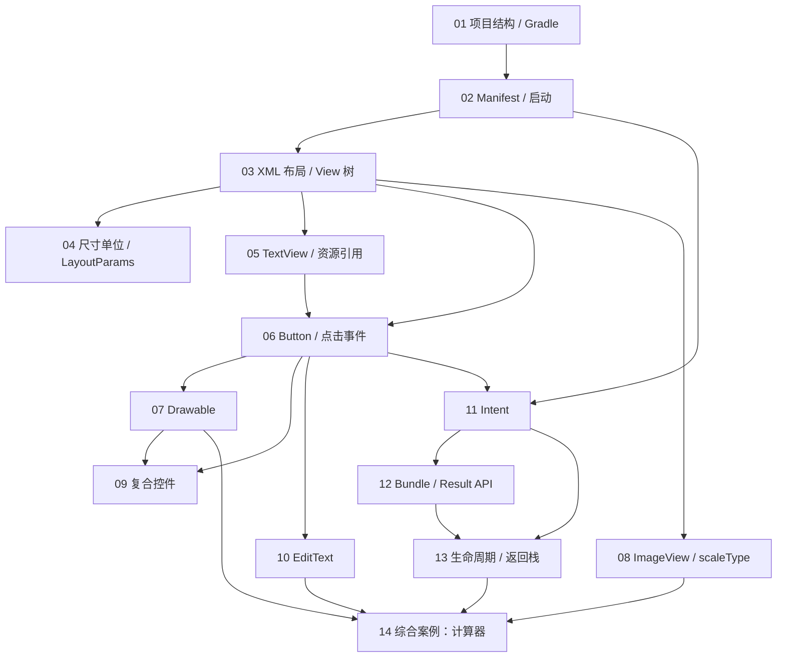

# LEARNING_ROADMAP —— 章节规划

> 读者：具备基本 Java 语法（类、接口、继承、集合、异常），正在学 Android 的初学者。
> 技术路线：**Java + XML View + Android SDK / AndroidX**。
> 状态：**规划稿，待确认后开始写正文。**
> 编码基线：`main` @ `e6271cd`（工作区另有未提交的 `:intermediatecontrols` 改动）

---

## 一、规划原则

1. **按知识依赖排序，不按文件名或模块排序。** 三个模块是平行存在的，章节必须横跨模块取材。
2. **每章聚焦一个技术主题，回答一个真实问题。** 不为凑章节数重复知识点。
3. **章节粒度由"素材密度"决定，不由目标字数决定。** 见第五节。
4. 项目没有实现的内容，标为**扩展知识**，不伪装成已有功能。

### 关于"每章 6000～7000 字"的诚实核算

这是本规划里唯一需要先泼冷水的地方。

- **可写素材 = 源码行数 × 知识密度 × 可观察现象数。**
- 本项目 34 个 Activity 中，约 **一半是"空壳"**（只有 `setContentView`），
  真正的教学内容在 **XML 布局**里，而不在 Java 里。
- 因此有些章节（如第 03、07 章）素材极密，7000 字写不完；
  有些章节（如原设想中的"ImageView 单章"）若只有 Java 视角，会严重不足 ——
  但实际读到 `activity_main_image_view.xml` 后发现它有 **8 种 scaleType 全量对比**，
  素材反而很足，所以**保留为独立章节**。

结论：**14 章，全部按 6000～7000 字（口径 B）规划**，但下表仍标注素材密度，
写作时若某章实测只到 5000 字，**优先考虑合并或拆分，而不是注水**。

---

## 二、章节总表

| 章 | 标题 | 核心问题 | 前置 | 素材密度 | 字数预算 |
|---|---|---|---|---|---|
| 01 | 项目结构、Gradle 构建与多模块 | 一个 Android 项目的构成与构建过程 | 无 | 高 | 6000–7000 |
| 02 | AndroidManifest 与应用启动流程 | 点一下图标，系统怎么找到并打开我的页面？ | 01 | 高 | 6000–7000 |
| 03 | XML 布局与 View 树 | XML 是怎么变成屏幕上的界面的？ | 02 | 高 | 6500–7500 |
| 04 | 尺寸单位、padding/margin/gravity 与 LayoutParams | 为什么 300 有时是 300px 有时不是 | 03 | 中高 | 5500–6500 |
| 05 | TextView、颜色与资源引用机制 | `@string/xxx` 和 `R.id.xxx` 到底怎么连起来的 | 03 | 高 | 6500–7500 |
| 06 | Button 与四种点击事件写法 | 点击是怎么从手指传到我代码里的 | 03、05 | 高 | 7000–8000 |
| 07 | Drawable：shape / selector / 九宫格 | 为什么我的按钮背景图不显示/变形 | 06 | 高 | 6500–7500 |
| 08 | ImageView、scaleType 与图片资源 | 同一张图为什么显示大小不一样 | 03 | 高 | 6000–7000 |
| 09 | CheckBox / Switch / RadioButton 与 CompoundButton | 为什么自定义勾选图变成了一块纯色 | 06、07 | 高 | 6500–7500 |
| 10 | EditText：焦点、校验、TextWatcher 与软键盘 | 怎么知道用户输完了、输错了 | 06 | 高 | 6500–7500 |
| 11 | Intent：显式与隐式跳转 | `startActivity` 为什么能打开另一个页面 | 02、06 | 高 | 6000–7000 |
| 12 | Bundle 传值与 Activity Result API | 页面之间怎么传数据、怎么拿到返回结果 | 11 | 高 | 6500–7500 |
| 13 | 生命周期、返回栈与启动模式 | 按返回键时到底发生了什么 | 11、12 | 中（需实验补足）⚠️ | 6000–7000 |
| 14 | 综合案例：简易计算器 | 把前面所有东西串起来 | 03–13 | 高 | 6500–7500 |

**合计约 9 万字。** 这是一个需要持续投入的工程，不是一次对话能完成的量。

### 依赖关系图



---

## 三、各章详细规划

### 第 01 章　项目结构、Gradle 构建与多模块

- **学习目标**：看懂一个 Android 项目的目录与构建配置；理解"写完代码到装上手机"中间发生了什么。
- **核心问题**：`app/` 目录里到底有什么？`build.gradle.kts` 里的每一行在干什么？为什么这个项目有四个模块？
- **前置**：无（Java 基础即可）。
- **源码依据**：
  `settings.gradle.kts`、`build.gradle.kts`、`gradle/libs.versions.toml`、三个模块的 `build.gradle.kts`、`.gitignore`。
- **核心 API / 概念**：`compileSdk` / `minSdk` / `targetSdk` 三者区别、`namespace` 与 `applicationId`、
  Version Catalog、`plugins { alias(...) }`、`sourceCompatibility`。
- **运行流程**：Gradle 配置阶段 → 任务图 → 编译 → 打包 APK → 安装。
  可实际操作：`./gradlew :mytextapplication:assembleDebug`，观察 `build/outputs/apk/`。
- **实验**：① 把 `minSdk` 临时改成 24 看是否同步；② 注释掉一个模块的 `include`，观察 Gradle 报错。
- **本章特色素材**：`viewBinding = true` 只在 `:mytextapplication` 开启，
  但该模块所有代码仍用 `findViewById` —— 引出"配置开了 ≠ 自动生效"。
- **前后关系**：为全书提供"文件在哪、怎么构建"的地图。
- **篇幅预算**：导读 10% / 概念 25% / 目录与配置逐项解析 35% / 常见错误 20% / 总结 10%。

### 第 02 章　AndroidManifest 与应用启动流程

- **学习目标**：理解 Manifest 是应用的"身份证 + 注册表"；理解应用启动链路。
- **核心问题**：系统怎么知道点哪个图标该启动哪个 Activity？为什么有的 Activity 写了却打不开？
- **前置**：第 01 章。
- **源码依据**：4 份 `AndroidManifest.xml`；`CalculatorActivity`（launcher + 自定义 action）；
  `ReadResourceActivity`（meta-data + `PackageManager` 读取）；两个**未注册**的 `MainActivity`。
- **核心 API**：`<intent-filter>`、`<action MAIN>`、`<category LAUNCHER>`、`android:exported`、`<meta-data>`、`PackageManager.GET_META_DATA`。
- **运行流程**：Launcher 查询 → `PackageManagerService` 匹配 intent-filter → `ActivityThread` → `onCreate`。
- **实验**：① 把 `CalculatorActivity` 的 launcher intent-filter 注释掉，看是否还能从桌面启动；
  ② 给未注册的 `MainActivity` 加上声明，观察能否启动。
- **难点提示**：`exported` 在 `targetSdk 31+` 后强制显式声明，本项目所有 Activity 都写了 —— 值得解释原因。
- **篇幅预算**：导读 10% / Manifest 结构 25% / 启动链路 + Mermaid 流程图 30% / 注册规则与踩坑 25% / 总结 10%。

### 第 03 章　XML 布局与 View 树

- **学习目标**：能读懂并自己写 `LinearLayout` / `RelativeLayout` / `GridLayout` / `ScrollView` 的嵌套布局。
- **核心问题**：XML 是怎么变成屏幕上一个个可点击的对象的？
- **前置**：第 02 章。
- **源码依据**：`activity_main_linear_layout.xml`（嵌套 + 权重均分）、
  `activity_main_grid_layout.xml`（`columnCount` + `layout_columnWeight` 比例 1:2:1:1）、
  `activity_main_relative_layout.xml`、`activity_main_scroll_view.xml`（🔍 待补读）。
- **核心概念**：View 树、父容器与子 View、`match_parent` / `wrap_content` / 固定值 / `0dp`+weight、
  LayoutInflater 充气过程。
- **运行流程**：`setContentView` → `LayoutInflater.inflate` → 递归建 View 对象树 → `measure` → `layout` → `draw`。
- **实验**：① 把 `activity_main_grid_layout.xml` 里第四个 `layout_columnWeight` 从 1 改成 3，观察宽度变化；
  ② 在 `ScrollView` 里放两个子 View，观察报错信息。
- **篇幅预算**：导读 10% / 四种布局逐类解析 35% / 充气与绘制流程 25% / 常见错误 20% / 总结 10%。

### 第 04 章　尺寸单位、padding/margin/gravity 与 LayoutParams

- **学习目标**：彻底搞清 `dp` / `sp` / `px`；能区分 margin 与 padding、gravity 与 layout_gravity。
- **核心问题**：为什么代码里设置宽度要"先转 dp"？为什么 `android:padding` 和 `android:layout_margin` 效果看起来像但又不一样？
- **前置**：第 03 章。
- **源码依据**：`utils/Utils.java`（`dp2px` 全实现）、`MainViewBorderActivity.java`
  （`getLayoutParams` → 改值 → `setLayoutParams` 三段式）、`MainViewGravityActivity`、`MainViewMarginPaddingActivity`（🔍 布局待补读）。
- **核心 API**：`DisplayMetrics.density`、`dp2px` 公式 `dp * density + 0.5f`、`ViewGroup.LayoutParams`、
  `getLayoutParams()` 返回的是**父容器**的参数对象。
- **运行流程**：为什么 `layoutParams.width = 300` 是"300 像素"（px），以及屏幕密度如何影响观感。
- **实验**：① 在 `MainViewBorderActivity` 中把 `Utils.dp2px(this, 300)` 改成直接写 `300`，对比宽度；
  ② 把 `getLayoutParams()` 改成 `new ViewGroup.LayoutParams(...)` 后忘记 `setLayoutParams`，观察无效。
- **常见错误**：忘记调用 `setLayoutParams`；把 `dp` 当 `px` 用；`gravity` 与 `layout_gravity` 混用。
- **篇幅预算**：导读 10% / 单位与密度 25% / LayoutParams 与三段式 30% / 定位属性对比 25% / 总结 10%。

### 第 05 章　TextView、颜色与资源引用机制

- **学习目标**：理解 `R` 类与资源目录的映射；掌握文字、颜色、背景的三种设置途径。
- **核心问题**：`R.string.hello` 这个"类"是哪来的？为什么 `setTextColor(0x00ff00)` 文字会消失？
- **前置**：第 03 章。
- **源码依据**：`MainTextActivity.java`（`findViewById` + `setText(R.string.hello)`）、
  `MainTextColorActivity.java`（注释中保留 4 种颜色实验）、`MainTextSizeActivity.java`、
  `strings.xml`（`:mytextapplication` 与 `:myactivityapplication`）、
  `ReadResourceActivity.java`（`getString` 与 XML 中 `@string/xxx` 的等价性）。
- **核心知识**：
  - `res/` 子目录 → `R` 子类 的映射规则（`layout/` → `R.layout`、`values/strings.xml` → `R.string`）。
  - **`R` 类由 aapt2 在编译期生成**，不是手写。
  - **ARGB 与 alpha 坑**（本章最有价值的点）：
    `MainTextColorActivity` 注释里写着 `0x11111111`（8 位）与 `0x00ff00`（6 位）。
    传入 6 位值时高位补 0 当 alpha = 完全透明 → 文字看不见。
  - `strings.xml` 里同时存在 `<string>` 与 `<color>` → 说明 **`values/` 下的文件按"资源类型"归类，不按文件名归类**。
- **实验**：① 恢复 `MainTextColorActivity` 中被注释的颜色代码，逐个观察；
  ② 在 `colors.xml` 新增一个颜色，用 `@color/xxx` 引用。
- **篇幅预算**：导读 10% / R 类与资源映射 25% / 文本与颜色 API 30% / ARGB 实验与排查 25% / 总结 10%。

### 第 06 章　Button 与四种点击事件写法

- **学习目标**：掌握四套等价但场景不同的点击绑定方式，理解"回调"在 Android 里的落地形式。
- **核心问题**：手指按下去之后，代码是怎么被调用的？
- **前置**：第 03、05 章。
- **源码依据**：`MainButtonClickActivity.java`（**一个文件三种写法**）、
  `MainButtonStyleActivity.java`（`android:onClick="doClick"` 第 4 种）、
  `MainButtonEnabledActivity.java`（`setEnabled`）、`activity_main_button_click.xml`。
- **四种写法**（本章骨架）：
  | 写法 | 代码位置 | 适用场景 |
  |---|---|---|
  | 匿名内部类 / Lambda | `setOnClickListener(v -> ...)` | 单个按钮，逻辑简单 |
  | 独立静态内部类 | `MyOnClickListener implements View.OnClickListener` | 逻辑可复用、避免内存泄漏 |
  | Activity 实现接口 | `implements View.OnClickListener` + `v.getId()` | 大量按钮统一分发 |
  | XML `android:onClick` | `public void doClick(View view)` | 快速原型（**但用反射，性能与可维护性差**） |
- **核心概念**：回调接口、`View.OnClickListener` 与 `OnLongClickListener`、`v.getId()` 分发、
  `setEnabled(false)` 后为什么点击无效（事件不再分发）。
- **实验**：给 `btn_long` 的 `OnLongClickListener` 返回值从 `true` 改成 `false`，观察点击事件是否也会触发。
- **篇幅预算**：导读 10% / 事件模型与分发 25% / 四种写法逐段解析 40% / 启用状态与常见错误 15% / 总结 10%。

### 第 07 章　Drawable：shape / selector / 九宫格

- **学习目标**：能用 XML 画背景；理解状态选择器与九宫格拉伸机制。
- **核心问题**：为什么 `android:background="@drawable/nine_origin"` 在 `<Button>` 上不显示，在 `AppCompatButton` 上就正常？
- **前置**：第 06 章。
- **源码依据**：`shape_rectangle.xml`（**`<solid>`/`<stroke>`/`<corners>`/`<gradient>` 四要素齐全**）、
  `shape_oval.xml`、`btn_nine_selector.xml`（写法 A：引用外部图）、
  `btn_background.xml`（**写法 B：`<shape>` 内联进 `<item>`**）、
  `activity_drawable_nine.xml`（**作者手写注释解释 `AppCompatButton`**）、
  `DrawableActivity.java`（Java 切换两个 shape）、`nine_origin.9.png` vs `origin.png`。
- **核心概念**：`<shape>` 子标签语义、`<selector>` 状态匹配**从上到下、先匹配先赢**、
  `.9.png` 的一像素黑边与可拉伸区域、`Drawable` 是"可绘制对象"而非"图片"。
- **本章最大亮点**：**Material3 主题把 `<Button>` 替换成 `MaterialButton`，`android:background` 被覆盖** ——
  项目里已有现成的一手记录与解法。
- **实验**：① 把 `activity_drawable_nine.xml` 里的 `AppCompatButton` 改回 `Button`，观察背景消失；
  ② 把 `btn_nine_selector.xml` 两个 `<item>` 顺序对调，观察按下状态是否还生效。
- **篇幅预算**：导读 10% / shape 四要素 25% / selector 两种写法 25% / 九宫格机制 20% / 排错 20%。

### 第 08 章　ImageView、scaleType 与图片资源

- **学习目标**：理解 `scaleType` 的 8 种取值各自在做什么；理解图片资源的密度匹配。
- **核心问题**：同一个 `260dp` 高的 ImageView，为什么不同 `scaleType` 显示效果完全不同？
- **前置**：第 03 章。
- **源码依据**：`activity_main_image_view.xml`（**8 种 scaleType 全量对比**：fitCenter / centerCrop / center /
  centerInside / fitXY / fitStart / fitEnd / matrix，外加 `ImageButton` 与 `Button#drawableStart`）、
  `MainImageViewActivity.java`（⚠️ **在 Manifest 中被注释，需先取消注释才能实验**）、`tos_cn.png`。
- **核心概念**：图片原始尺寸 vs View 尺寸、缩放与裁剪的区别、`matrix` 为何能溢出边界、
  `contentDescription` 与无障碍、`drawable-xxxhdpi` 密度目录的作用。
- **实验**：① 取消 `MainImageViewActivity` 的 Manifest 注释后逐个对比 8 种 scaleType；
  ② 把 `tos_cn.png` 复制一份到 `drawable-xxhdpi/`，观察显示尺寸变化。
- **篇幅预算**：导读 10% / 缩放模型 30% / 8 种取值逐项对比 35% / 密度与常见错误 15% / 总结 10%。

### 第 09 章　CheckBox / Switch / RadioButton 与 CompoundButton

- **学习目标**：掌握三类"可勾选"控件的监听方式；理解它们的共同父类抽象。
- **核心问题**：为什么自定义的勾选图片变成了一块纯紫色方块？为什么 RadioButton 的回调给的是 id 而不是控件？
- **前置**：第 06、07 章。
- **源码依据**：`CheckBoxActivity.java`、`SwitchActivity.java`、`RadioButtonActivity.java`、
  `activity_check_box.xml`（**13 行手写注释解释 `buttonTint="@null"`**）、
  `checkbox_selector.xml`、`checkbox_checked.png` / `checkbox_unchecked.png`。
- **核心概念**：
  - `CompoundButton` 是 CheckBox / Switch / RadioButton 的共同父类 → 同一个 `OnCheckedChangeListener`。
  - `RadioGroup.OnCheckedChangeListener` 的回调签名是 `(RadioGroup, int checkedId)`，
    与 `CompoundButton.OnCheckedChangeListener` 的 `(CompoundButton, boolean)` 不同 ——
    **两个同名接口、不同签名，是新手极易混淆的点**。
  - **Material3 `buttonTint` + `SRC_IN` 染色坑**（一手记录）：
    图片被整体染成 `colorPrimary`、只保留 alpha → "蓝色方块 + 白勾"变成纯紫色方块。
    解法：`android:buttonTint="@null"` + `app:buttonTint="@null"`。
- **通用判断法**（可写成"排错口诀"）：Material 主题下自定义图片"消失"或"变样"，先怀疑 tint；
  **纯色块 = 被 SRC_IN 染色的典型特征**，不代表图没加载。
- **实验**：移除两个 `buttonTint="@null"`，观察变化；再单独去掉其中一个，验证注释里的说法是否准确。
- **篇幅预算**：导读 10% / CompoundButton 体系 25% / 三类控件解析 25% / tint 坑复盘 25% / 总结 15%。

### 第 10 章　EditText：焦点、校验、TextWatcher 与软键盘

- **学习目标**：掌握输入框的常用配置、焦点事件、内容变化监听与软键盘控制。
- **核心问题**：怎么在用户输完之后自动校验？怎么在输入满 11 位时自动收起键盘？
- **前置**：第 06 章。
- **源码依据**：`EditTextFocusActivity.java`（`OnFocusChangeListener` + 正则
  `^1[3-9]\d{9}$` + `setError` + `Toast`）、
  `EditHideActivity.java`（`private class HideTextWatcher implements TextWatcher`，长度达标即收键盘）、
  `utils/ViewUtil.java`（`InputMethodManager` + `hideSoftInputFromWindow(view.getWindowToken(), 0)`）、
  `EditTextActivity.java`、`edit_text.xml` / `edit_text_focus.xml` / `edit_text_normal.xml`。
- **核心概念**：`TextWatcher` 三个回调（`beforeTextChanged` / `onTextChanged` / `afterTextChanged`）的**分工与调用时机**、
  为什么作者只在 `afterTextChanged` 里写逻辑、`Editable` 与 `CharSequence` 的区别、
  `inputType`、`imeOptions`、`windowSoftInputMode`、焦点与 `requestFocus`。
- **实验**：① 只在 `onTextChanged` 里写同样的逻辑，观察行为差异；
  ② 把正则 `^1[3-9]\d{9}$` 改成 `^1\d{10}$`，对比校验结果。
- **篇幅预算**：导读 10% / 输入配置 15% / 焦点与校验 25% / TextWatcher 三回调 25% / 软键盘控制 15% / 总结 10%。

### 第 11 章　Intent：显式与隐式跳转

- **学习目标**：理解 Intent 是"要做一件事的意图描述"；掌握五种跳转写法。
- **核心问题**：`startActivity(new Intent(this, OtherActivity.class))` 为什么能打开另一个页面？
- **前置**：第 02、06 章。
- **源码依据**：`ActStartActivity.java`（最短显式跳转）、
  `ActFinishActivity.java`（`finish()` 返回 + 两个控件共用一次监听）、
  `IntentActivity.java`（**四种并列**：`setComponent(ComponentName)` / `ACTION_DIAL + tel:` /
  `ACTION_SENDTO + smsto:` / 自定义 action `android.intent.action.ZZZ`）、
  `mytextapplication/AndroidManifest.xml`（自定义 action 的注册端）、`res/xml/shortcuts.xml`（🔍 彩蛋）。
- **核心概念**：显式 vs 隐式 Intent、`setComponent` / `setAction` / `setData` 的区别、
  `CATEGORY_DEFAULT` 为什么必须加、`Intent` 如何被 `PackageManager` 解析成具体组件、
  `finish()` 与返回键的关系。
- **运行流程**：用 Mermaid 画"显式跳转 vs 隐式跳转"两条解析路径的对比图。
- **实验**：① 把 `IntentActivity` 中自定义 action 的大小写改掉，观察 `ActivityNotFoundException`；
  ② 试着用隐式 Intent 打开一个未被任何应用注册的 action。
- **篇幅预算**：导读 10% / Intent 是什么 20% / 显式跳转 20% / 隐式跳转与匹配规则 30% / 排错 20%。

### 第 12 章　Bundle 传值与 Activity Result API

- **学习目标**：掌握页面间双向传值；理解为什么 `startActivityForResult` 已被淘汰。
- **核心问题**：数据是怎么"跟着" Intent 走到下一个页面的？返回结果为什么用这种方式接收？
- **前置**：第 11 章。
- **源码依据**：`BundleSendActivity.java`（`Bundle.putString` ×2 → `intent.putExtras` →
  `register.launch(intent)`；**注释掉了 `startActivity`**，
  并用 `registerForActivityResult(new ActivityResultContracts.StartActivityForResult(), o -> {...})` 接收）、
  `BundleReceiveActivity.java`（`getIntent().getExtras()` 与 `getStringExtra()` 两种取值并列；
  `setResult(RESULT_OK, intent)` + `finish()` 回传）。
- **核心概念**：`Bundle` 的本质（键值对容器）、`putExtras` 与 `getExtras`、
  **`startActivityForResult` / `onActivityResult` 已废弃** → `ActivityResultLauncher` 的注册时机
  （必须在 `onCreate` 中、`STARTED` 之前注册）、`RESULT_OK` / `RESULT_CANCELED`、`setResult` 必须在 `finish` 之前。
- **值得点名的细节**：`BundleReceiveActivity` 里同一份数据用两套 API 取了两遍
  （`getExtras().getString()` 和 `getStringExtra()`）—— 写文章时如实解释两者等价、
  这是学习过程中的重复尝试，不要美化成"演示两种写法"。
- **实验**：① 注释掉 `setResult`，观察发送端是否还收到数据；
  ② 把 `registerForActivityResult` 移到按钮点击时注册，观察异常。
- **篇幅预算**：导读 10% / Bundle 机制 20% / 正向传值 20% / 结果回传与新 API 30% / 新旧 API 对比 20%。

### 第 13 章　生命周期、返回栈与启动模式

- **学习目标**：理解 Activity 从创建到销毁的过程；理解 `FLAG_ACTIVITY_*` 对返回栈的影响。
- **核心问题**：为什么从 B 返回 A 时 A 还在？`FLAG_ACTIVITY_REORDER_TO_FRONT` 到底做了什么？
- **前置**：第 11、12 章。
- **源码依据**：`StartupmodeActivity.java`（**自带 30 行中文注释**，推演
  `A → B → A → B` 的四种 Flag 行为）、`StartupmodefinishActivity.java`（与 A 互跳）。
- ⚠️ **素材缺口（必须正视）**：**项目里所有 Activity 都只覆写了 `onCreate`**，
  `onStart` / `onResume` / `onPause` / `onStop` / `onDestroy` / `onSaveInstanceState` **一处都没有**。
  因此本章不能靠"讲解现有代码"撑满篇幅。
- **补足方案**：把"亲手加日志"设计成本章主线的**实验任务**：
  ```java
  // 实验：在 StartupmodeActivity 中依次加入以下覆写，观察 Logcat 输出顺序
  @Override protected void onStart()   { super.onStart();   Log.d("Lifecycle", "onStart"); }
  @Override protected void onResume()  { super.onResume();  Log.d("Lifecycle", "onResume"); }
  @Override protected void onPause()   { super.onPause();   Log.d("Lifecycle", "onPause"); }
  @Override protected void onStop()    { super.onStop();    Log.d("Lifecycle", "onStop"); }
  @Override protected void onDestroy() { super.onDestroy(); Log.d("Lifecycle", "onDestroy"); }
  ```
  配合四种 Flag 观察返回栈变化，用 Mermaid 画栈的进出。
- **另一个实验**：旋转屏幕（或改系统语言）触发配置变更，观察 `onCreate` 是否被重新调用、
  `savedInstanceState` 是否为 null。
- **篇幅预算**：导读 10% / 生命周期概念 25% / 实验一：日志观察 25% / 返回栈与 Flag 25% / 总结 15%。

### 第 14 章　综合案例：简易计算器

- **学习目标**：把前 13 章的知识串成完整功能；体会"界面 / 状态 / 逻辑"三层如何分离。
- **核心问题**：19 个按钮、一个显示区，怎么组织才不乱？
- **前置**：第 03–13 章。
- **源码依据**：`CalculatorActivity.java`（205 行）、`activity_calculator.xml`（🔍 待补读）。
- **核心概念**：
  - 三个状态字段 `firstNumber` / `operator` / `newNumber` 构成的**隐式状态机** ——
    逐个分析它们何时被改，就能解释所有行为。
  - "所有按钮共用一个 `OnClickListener`，靠 `v.getId()` 分发"的**取舍**（对比第 06 章四种写法）。
  - `inputNumber` / `inputDecimal` / `setOperator` / `calculate` / `clearAll` / `clearEntry` /
    `squareRoot` / `reciprocal` / `formatResult` 的方法拆分。
  - `formatResult` 中 `result == (long) result` 的整数判断（`5.0` 显示成 `5`）。
  - 除零与负数开方的 `Error` 处理路径。
- **实验**：① 连续点击 `=` 观察结果；② 输入 `5` `+` `=` 观察行为；
  ③ 用前面学到的 `setEnabled` 优化（比如运算未完成时禁用 `=`），并说明这是**扩展改进**，不是项目原有功能。
- **篇幅预算**：导读 10% / 需求与界面 15% / 状态机逐字段分析 30% / 方法逐个解析 25% / 重构思考与总结 20%。

---

## 四、章节 ↔ 源码映射速查

| 章 | 主要 Java | 主要 XML / 资源 | 主要配置 |
|---|---|---|---|
| 01 | — | — | 全部 gradle 文件、`.gitignore` |
| 02 | `CalculatorActivity`, `ReadResourceActivity`, 两个 `MainActivity` | — | 4 份 `AndroidManifest.xml` |
| 03 | 4 个 Layout Activity | `activity_main_{linear,relative,grid,scroll}_*.xml` | — |
| 04 | `MainViewBorderActivity`, `MainViewGravityActivity`, `MainViewMarginPaddingActivity`, `Utils` | 对应 3 个 layout | — |
| 05 | `MainTextActivity`, `MainTextColorActivity`, `MainTextSizeActivity` | `strings.xml`, `colors.xml`, 对应 3 个 layout | — |
| 06 | `MainButtonClickActivity`, `MainButtonStyleActivity`, `MainButtonEnabledActivity` | `activity_main_button_click.xml` 等 | — |
| 07 | `DrawableActivity`, `DrawableNineActivity` | `shape_*.xml`, `btn_*_selector.xml`, `btn_background.xml`, `.9.png` | — |
| 08 | `MainImageViewActivity` | `activity_main_image_view.xml`, `tos_cn.png` | — |
| 09 | `CheckBoxActivity`, `SwitchActivity`, `RadioButtonActivity` | `activity_check_box.xml`, `checkbox_selector.xml` | — |
| 10 | `EditTextActivity`, `EditTextFocusActivity`, `EditHideActivity`, `ViewUtil` | `edit_text*.xml`, 对应 3 个 layout | — |
| 11 | `ActStartActivity`, `ActFinishActivity`, `IntentActivity` | `activity_intent.xml`, `shortcuts.xml` | `mytextapplication` Manifest（自定义 action） |
| 12 | `BundleSendActivity`, `BundleReceiveActivity` | 对应 2 个 layout | — |
| 13 | `StartupmodeActivity`, `StartupmodefinishActivity` | 对应 2 个 layout | — |
| 14 | `CalculatorActivity` | `activity_calculator.xml` | — |

---

## 五、待补充知识点清单（标为「扩展知识」，不得写成已有功能）

详见 [SOURCE_INDEX.md 第七节](SOURCE_INDEX.md#七明确不存在的知识点禁止写成项目已实现)。
摘要：**Fragment / Navigation、RecyclerView 与 Adapter、ViewModel / LiveData、
网络请求、本地存储、非 `onCreate` 的生命周期覆写、状态保存与恢复、运行时权限、
自定义 View、Parcelable、动画、多语言、主题切换** —— 本项目全部未实现。

若某章需要引用它们做对比（例如"第 12 章对比 Parcelable 与 Serializable"），
必须显式写"本项目未使用，这里作为扩展知识"。

---

## 六、写作优先级建议

**不要按 01→14 顺序一路写下去。** 建议按下表分批，先易后难、先有反馈再投入：

| 批次 | 章节 | 理由 |
|---|---|---|
| **第 1 批（试写）** | **07 Drawable** | 素材最密、有一手踩坑记录和两处作者注释、实验现象直观（图显示/不显示）。用它定下全书风格、深度、代码引用方式。 |
| 第 2 批 | 06 → 09 | 06 是 07 的前置且素材同样足；09 承接 07 的 tint 坑，形成"坑 → 复盘"的呼应。 |
| 第 3 批 | 03 → 05 → 04 → 08 | 界面基础四章，数量多但套路相近，可批量推进。 |
| 第 4 批 | 10 | EditText 素材足，与前面独立。 |
| 第 5 批 | 11 → 12 → 13 | 必须成组，13 含实验补足工作。 |
| 第 6 批 | 02 → 01 | 放在后面写，因为此时你对项目已有全局认识，反而写得准。 |
| 第 7 批 | 14 | 综合案例，最后写。 |

**为什么 01 章后置**：第 01 章要讲"这个项目为什么这样组织"，
等你写完后半部分再回头看 `settings.gradle.kts`，讲得会准得多。

---

## 七、下一步

1. **请你审阅本规划**：章节边界、顺序、素材密度判断是否认同？哪些要合并/拆分/删除？
2. 确认后按第六节的"第 1 批"试写 **第 07 章 Drawable**。
3. 试写完成后，用 `tools/count_chars.py` 复核篇幅，再决定是否把同样标准铺开到后续章节。
