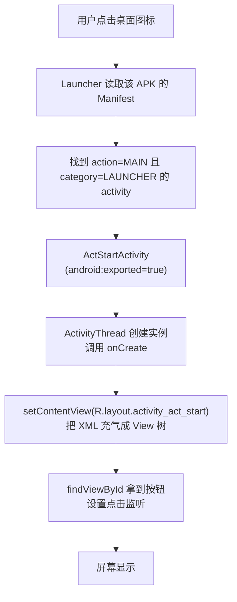

# PROJECT_MAP —— 项目真实结构分析

> 本文档的所有结论均来自对仓库文件的直接读取。
> 生成日期：2026-10-13
> 代码基线：`main` 分支，最后一次提交 `e6271cd feature: Android 学习项目: 图形Drawable`
> ⚠️ 分析时工作区存在**未提交改动**（见文末「工作区状态」），本文件描述的是**工作区当前内容**，不是 `HEAD`。

---

## 一、项目身份

| 项 | 值 | 来源 |
|---|---|---|
| 仓库名 | `Android_Study` | README.md |
| rootProject | `MyFirstApp` | `settings.gradle.kts` |
| 远程仓库 | `https://github.com/2002312bugisme/Android_Study.git` | `git remote -v` |
| 默认分支 | `main` | `git branch --show-current` |
| 构建系统 | Gradle + Kotlin DSL（`*.gradle.kts`） | 根目录 |
| 包名前缀 | `com.zzz.*` | 各模块 `namespace` |

**这是一个多模块（multi-module）单仓库项目**，不是常见的单 `app` 模板。
四个模块并列，用"一个模块一个学习主题"的方式组织，而不是拆成 library + app 的工程结构。

---

## 二、模块与技术栈实况

### 2.1 模块清单

`settings.gradle.kts` 中显式 include 了四个模块：

| 模块 | namespace | 角色 | 启动 Activity | Activity 数 | Layout 数 |
|---|---|---|---|---|---|
| `:app` | *(Compose 模板)* | Jetpack Compose 试验田 | `MainActivity` | — | 1 |
| `:mytextapplication` | `com.zzz.mytextapplication` | 文本、View、布局、事件、图片 | `CalculatorActivity` | 15 | 15 |
| `:myactivityapplication` | `com.zzz.myactivityapplication` | Activity、Intent、Bundle、启动模式、资源读取 | `ActStartActivity` | 9 | 9 |
| `:intermediatecontrols` | `com.zzz.intermediatecontrols` | Drawable、复合控件、EditText、输入法 | `EditHideActivity` | 10 | 10 |

> **`:app` 不在本博客范围内**：它是 Compose + Kotlin 模板，与"Java + XML View"主线无关。
> 但它可以在第 01 章作为**对照**出现 —— 说明"同一个仓库里可以并存两种技术范式"。

### 2.2 技术栈实况表

| 项 | 实际值 | 来源 | 备注 |
|---|---|---|---|
| AGP | `9.3.2` | `gradle/libs.versions.toml` | 版本目录（Version Catalog）管理 |
| Kotlin | `2.2.10` | 同上 | 仅 `:app` 的 compose 插件使用 |
| `compileSdk` | `release(37)` | 各模块 `build.gradle.kts` | AGP 9 的新 DSL 写法 |
| `minSdk` | `28` | 同上 | Android 9.0 |
| `targetSdk` | `37` | 同上 | |
| Java 兼容级别 | `VERSION_11` | 同上 | 三个 Java 模块一致 |
| 主题 | `Theme.Material3.DayNight.NoActionBar` | `res/values/themes.xml` | **Material3，多处踩坑源头** |
| `viewBinding` | 仅 `:mytextapplication` 为 `true` | 该模块 `build.gradle.kts` | **但代码里未使用**，全部仍用 `findViewById` |
| 版本目录 | `gradle/libs.versions.toml` | 根目录 | `alias(libs.plugins.*)` 引用 |
| 依赖仓库 | `google()` / `mavenCentral()`，`FAIL_ON_PROJECT_REPOS` | `settings.gradle.kts` | 模块内不得单独声明仓库 |

### 2.3 依赖对比（三个 Java 模块）

| 依赖 | mytextapplication | myactivityapplication | intermediatecontrols |
|---|---|---|---|
| `androidx.activity:activity-ktx` | ✅ | ✅ | ✅ |
| `androidx.appcompat:appcompat` | ✅ | ✅ | ✅ |
| `androidx.constraintlayout` | ✅ | ✅ | ✅ |
| `com.google.android.material` | ✅ | ✅ | ✅ |
| `androidx.navigation:fragment` / `ui` | ✅ | ❌ | ❌ |
| `junit` / `espresso` / `androidx.junit` | ✅ | ✅ | ✅ |

> ⚠️ **待核实**：`:mytextapplication` 引入了 `navigation-fragment` 与 `navigation-ui`，
> 但在已读源码中**没有发现任何 Navigation 组件（`NavHostFragment`、`NavController`）的使用**。
> 属于"依赖已加、功能未用"。写第 01 章时需核实，不要写成"项目使用了 Navigation"。

---

## 三、应用入口与启动流程

三个 Java 模块各自是**独立可安装的 APK**（都用了 `com.android.application` 插件），
所以它们有不同的 launcher 入口 —— 这一点在单模块项目里遇不到，是很好的教学点。

| 模块 | launcher Activity | 额外 intent-filter / meta-data |
|---|---|---|
| `:mytextapplication` | `.CalculatorActivity` | 额外注册自定义 action `android.intent.action.ZZZ` + `CATEGORY_DEFAULT` |
| `:myactivityapplication` | `.ActStartActivity` | 注册 `android.app.shortcuts` → `@xml/shortcuts` |
| `:intermediatecontrols` | `.EditHideActivity` | 无 |

`MAIN` / `LAUNCHER` 的标准写法（三个模块完全一致，可直接引用）：

```xml
<intent-filter>
    <action android:name="android.intent.action.MAIN" />
    <category android:name="android.intent.category.LAUNCHER" />
</intent-filter>
```

启动流程（以 `:myactivityapplication` 为例）：



---

## 四、Activity ↔ Layout ↔ Java 三方映射

这是写博客时最常查的表。**灰色标注 ⚠️ 的条目在 Manifest 中未注册或已被注释**。

### 4.1 `:mytextapplication`（15 个 Activity）

| Activity | Layout | Manifest 注册 | 章节 |
|---|---|---|---|
| `MainTextActivity` | `activity_main_text.xml` | ❌ 未注册 | 05 |
| `MainTextColorActivity` | `activity_main_text_color.xml` | ⚠️ 已注释 | 05 |
| `MainTextSizeActivity` | `activity_main_text_size.xml` | ❌ 未注册 | 05 |
| `MainViewBorderActivity` | `activity_main_text_border.xml` | ✅ | 04 |
| `MainViewMarginPaddingActivity` | `activity_main_view_margin_padding.xml` | ✅ | 04 |
| `MainViewGravityActivity` | `activity_main_view_gravity.xml` | ✅ | 04 |
| `MainLinearLayoutActivity` | `activity_main_linear_layout.xml` | ✅ | 03 |
| `MainRelativeLayoutActivity` | `activity_main_relative_layout.xml` | ✅ | 03 |
| `MainGridLayoutActivity` | `activity_main_grid_layout.xml` | ✅ | 03 |
| `MainScrollViewActivity` | `activity_main_scroll_view.xml` | ✅ | 03 |
| `MainButtonStyleActivity` | `activity_main_button_style.xml` | ✅ | 06 |
| `MainButtonClickActivity` | `activity_main_button_click.xml` | ✅ | 06 |
| `MainButtonEnabledActivity` | `activity_main_button_enabled.xml` | ✅ | 06 |
| `MainImageViewActivity` | `activity_main_image_view.xml` | ⚠️ 已注释 | 08 |
| `CalculatorActivity` | `activity_calculator.xml` | ✅ **launcher** | 14 |

### 4.2 `:myactivityapplication`（9 个 Activity）

| Activity | Layout | Manifest 注册 | 章节 |
|---|---|---|---|
| `MainActivity` | `activity_main.xml` | ❌ 未注册（死代码） | — |
| `ReadResourceActivity` | `activity_read_resource.xml` | ✅ `exported=true` | 02 / 05 |
| `ActStartActivity` | `activity_act_start.xml` | ✅ **launcher** + shortcuts | 11 |
| `ActFinishActivity` | `activity_act_finish.xml` | ✅ | 11 |
| `IntentActivity` | `activity_intent.xml` | ✅ | 11 |
| `BundleSendActivity` | `activity_bundle_send.xml` | ✅ | 12 |
| `BundleReceiveActivity` | `activity_bundle_receive.xml` | ✅ | 12 |
| `StartupmodeActivity` | `activity_startupmode.xml` | ✅ | 13 |
| `StartupmodefinishActivity` | `activity_startupmodefinish.xml` | ✅ | 13 |

### 4.3 `:intermediatecontrols`（10 个 Activity）

| Activity | Layout | Manifest 注册 | 章节 |
|---|---|---|---|
| `MainActivity` | `activity_main.xml` | ❌ 未注册（死代码） | — |
| `DrawableActivity` | `activity_drawable.xml` | ✅ | 07 |
| `DrawableNineActivity` | `activity_drawable_nine.xml` | ✅ | 07 |
| `DrawableStateActivity` | `activity_drawable_state.xml` | ✅ | 07 |
| `CheckBoxActivity` | `activity_check_box.xml` | ✅ | 09 |
| `SwitchActivity` | `activity_switch.xml` | ✅ | 09 |
| `RadioButtonActivity` | `activity_radio_button.xml` | ✅ | 09 |
| `EditTextActivity` | `activity_edit_text.xml` | ✅ | 10 |
| `EditTextFocusActivity` | `activity_edit_text_focus.xml` | ✅ | 10 |
| `EditHideActivity` | `activity_edit_hide.xml` | ✅ **launcher** | 10 |

---

## 五、资源与配置的引用关系

### 5.1 已确认的资源文件

```
mytextapplication/src/main/res/
├── drawable/   btn_background.xml ⭐, tos_cn.png ⭐, ic_launcher_*
├── layout/     15 个 activity_*.xml
└── values/     colors.xml, strings.xml, themes.xml

myactivityapplication/src/main/res/
├── drawable/   bg_button_primary.xml, goback.png ⭐, ic_launcher_*
├── layout/     9 个 activity_*.xml
├── xml/        shortcuts.xml ⭐
└── values/     colors.xml, strings.xml, themes.xml

intermediatecontrols/src/main/res/
├── drawable/   shape_rectangle.xml ⭐, shape_oval.xml, btn_nine_selector.xml,
│               checkbox_selector.xml ⭐, checkbox_checked.png, checkbox_unchecked.png,
│               edit_text.xml ⭐, edit_text_focus.xml, edit_text_normal.xml,
│               nine_origin.9.png ⭐, origin.png ⭐, ic_launcher_*
├── layout/     10 个 activity_*.xml
└── values/     colors.xml, strings.xml, themes.xml
```

⭐ = 已在源码中确认被引用，可作文博客示例。

### 5.2 值得注意的引用链条

**（1）selector 的两种写法**（第 07 章核心素材）

```text
写法 A：引用外部 drawable
  btn_nine_selector.xml ──引用──> nine_origin.9.png
                        ──引用──> origin.png

写法 B：把 <shape> 内联进 <item>
  btn_background.xml    ──内含──> <shape> 节点 ×2（state_pressed / 默认）
```

**（2）checkbox 的完整链路**（第 09 章，包含一个真实踩坑）

```text
activity_check_box.xml
  └─ AppCompatCheckBox#custom_checkbox
       └─ android:button = @drawable/checkbox_selector
            ├─ state_checked=true → checkbox_checked.png
            └─ 默认               → checkbox_unchecked.png
       └─ android:buttonTint = @null  ←── 关键修复（见下）
```

`activity_check_box.xml` 中作者留下的注释，解释了为什么必须写 `buttonTint="@null"`：

> `Theme.Material3.*` 的 `checkboxStyle` 会给 CheckBox 设上 `buttonTint`，且 `tintMode` 是 `SRC_IN`。
> 这个 tint 会作用到 `android:button` 指定的图片上，把图片统一染成 `colorPrimary`（紫色）、只保留 alpha，
> 结果"蓝色方块 + 白勾"变成一块纯紫色方块。

**这是一手踩坑记录，价值高于任何二手教程。**

**（3）EditText 焦点态背景**

```text
activity_edit_text_focus.xml
  └─ EditText
       └─ android:background = @drawable/edit_text
            ├─ state_focused=true → edit_text_focus.xml
            └─ 默认               → edit_text_normal.xml
```

`edit_text_focus.xml` / `edit_text_normal.xml` 的**具体内容尚未读取**（只确认了文件存在与被引用），
写第 10 章时需补读。

---

## 六、代码约定与惯例

### 6.1 Edge-to-Edge 样板（几乎每个 Activity 都有）

```java
EdgeToEdge.enable(this);
setContentView(R.layout.xxx);
ViewCompat.setOnApplyWindowInsetsListener(findViewById(R.id.main), (v, insets) -> {
    Insets systemBars = insets.getInsets(WindowInsetsCompat.Type.systemBars());
    v.setPadding(systemBars.left, systemBars.top, systemBars.right, systemBars.bottom);
    return insets;
});
```

- 出现在 **几乎所有已读 Activity** 中（`MainTextActivity`、`MainTextColorActivity`、`MainTextSizeActivity` 中被注释掉了）。
- 依赖 `findViewById(R.id.main)`，因此**每个布局的根节点都带 `android:id="@+id/main"`**。
- 这是 `targetSdk 35+` 强制 edge-to-edge 后的标准适配代码，**值得单独讲一节**（建议放在第 02 或第 04 章）。

### 6.2 命名风格

| 类型 | 前缀 | 实例 |
|---|---|---|
| TextView | `tv_` | `tv_hello`, `tv_message_single`, `tv_display` |
| Button | `btn_` | `btn_single`, `btn_all`, `btn_jump_toB` |
| EditText | `edit_` | `edit_phone`, `edit_password_hide` |
| 根布局 | `main` | 所有布局根节点 |
| 资源 | 小写下划线 | `shape_rectangle`, `checkbox_selector` |

### 6.3 工具类重复定义

`Utils.java`（`dp2px`）与 `DateUtils.java`（`getNowTime`）在 `:mytextapplication` 和
`:myactivityapplication` 中**内容完全相同、各存一份**。

> 这是很好的教学点：模块之间默认不可见，若要复用应抽 `library` 模块。
> 但**不要**在博客里把它写成"设计模式"，如实说明"因为模块间不共享代码，所以复制了一份"。

### 6.4 三种（实为四种）点击事件写法集中出现

`MainButtonClickActivity.java` 一个文件里就有三种；

| 写法 | 位置 |
|---|---|
| 独立静态内部类 | `MyOnClickListener implements View.OnClickListener` |
| Activity 自身实现接口 + `switch` by `v.getId()` | `implements View.OnClickListener` |
| Lambda（`setOnLongClickListener`） | `btn_long.setOnLongClickListener(v -> ...)` |
| **XML 中 `android:onClick` 属性** | `MainButtonStyleActivity#doClick(View view)` |

第 4 种写法很容易被忽略，是第 06 章的亮点。

---

## 七、发现的"真实困惑点"（天然的章节引入问题）

这些问题都来自代码本身，适合作为章节开头的"为什么"：

| # | 现象 | 涉及文件 | 章节 |
|---|---|---|---|
| 1 | 为什么每个 Activity 都有 8 行一模一样的 Edge-to-Edge 代码？ | 几乎所有 Activity | 02 / 04 |
| 2 | `viewBinding = true` 开着，代码却全用 `findViewById`，两者什么关系？ | `mytextapplication/build.gradle.kts` | 05 |
| 3 | `setTextColor(0x00ff00)` 为什么文字消失了？ | `MainTextColorActivity` 注释 | 05 |
| 4 | 为什么自定义 CheckBox 图片后变成一块纯紫色方块？ | `activity_check_box.xml` | 09 |
| 5 | 为什么 `<Button>` 的 `android:background` 不生效，而 `AppCompatButton` 生效？ | `activity_drawable_nine.xml` | 07 |
| 6 | `startActivity` 打开新页面后，按返回键为什么会回到这里？ | `ActStartActivity` / `ActFinishActivity` | 13 |
| 7 | `startActivityForResult` 已经废弃，那 `BundleSendActivity` 里用的是什么？ | `BundleSendActivity` | 12 |
| 8 | `strings.xml` 里为什么能写 `<color>`？ | `strings.xml` ×2 | 05 |
| 9 | 有些 Activity 写了却没在 Manifest 注册，会发生什么？ | 两个 `MainActivity` | 02 |
| 10 | `MainImageViewActivity` 在 Manifest 里被注释掉了，还能启动吗？ | `mytextapplication/AndroidManifest.xml` | 02 / 08 |

---

## 八、待核实清单（写对应章节前必须补）

- [ ] `activity_edit_text_focus.xml` / `edit_text_normal.xml` / `edit_text.xml` 的具体内容
- [ ] `activity_calculator.xml` 的布局结构（是否用了 `GridLayout`？第 14 章核心）
- [ ] `shortcuts.xml` 的内容（第 11 章"快捷方式"彩蛋）
- [ ] `activity_main_relative_layout.xml` / `activity_main_scroll_view.xml` / `activity_main_view_gravity.xml` 的内容
- [ ] `activity_main_text_size.xml` 中 `sp` 与 `dp` 的实际用法
- [ ] `activity_drawable_state.xml` 的内容（`DrawableStateActivity` 本身是空壳，逻辑全在 XML）
- [ ] `:mytextapplication` 引入 Navigation 依赖但未使用 —— 确认无误后如实说明
- [ ] `nine_normal.png` 已从工作区删除但仍登记在 `git status`（`AD`），确认是否需要 `git restore`
- [ ] `colors.xml` ×3 的内容差异

---

## 九、工作区状态（分析时的快照）

`git status --short` 摘要：

- **未提交改动集中在 `:intermediatecontrols`**：`CheckBoxActivity`、`EditTextActivity`、
  `EditTextFocusActivity`、`EditHideActivity`、`RadioButtonActivity`、`SwitchActivity`、
  `ViewUtil`、若干 layout/drawable、`AndroidManifest.xml`、`strings.xml`。
  → 对应"中级控件"这一轮学习，**尚未 commit**。
- `?? .workbuddy/` —— **未跟踪，包含工作记忆，不应推送到 GitHub**。
- `?? img/` —— 两张截图（`ScreenShot_2026-09-23_*.png`），可考虑作为 `assets/` 素材。

> 提交历史（按时间倒序）已经天然对应博客章节：
> `图形Drawable` → `数据传输 and 快捷方式` → `计算器 and Activity 生命周期` → `Layout and Button`。
> 说明这套"按主题分模块 + 按主题 commit"的习惯可以继续沿用。
