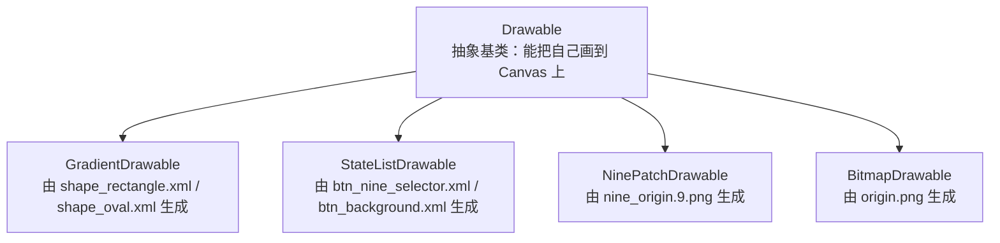
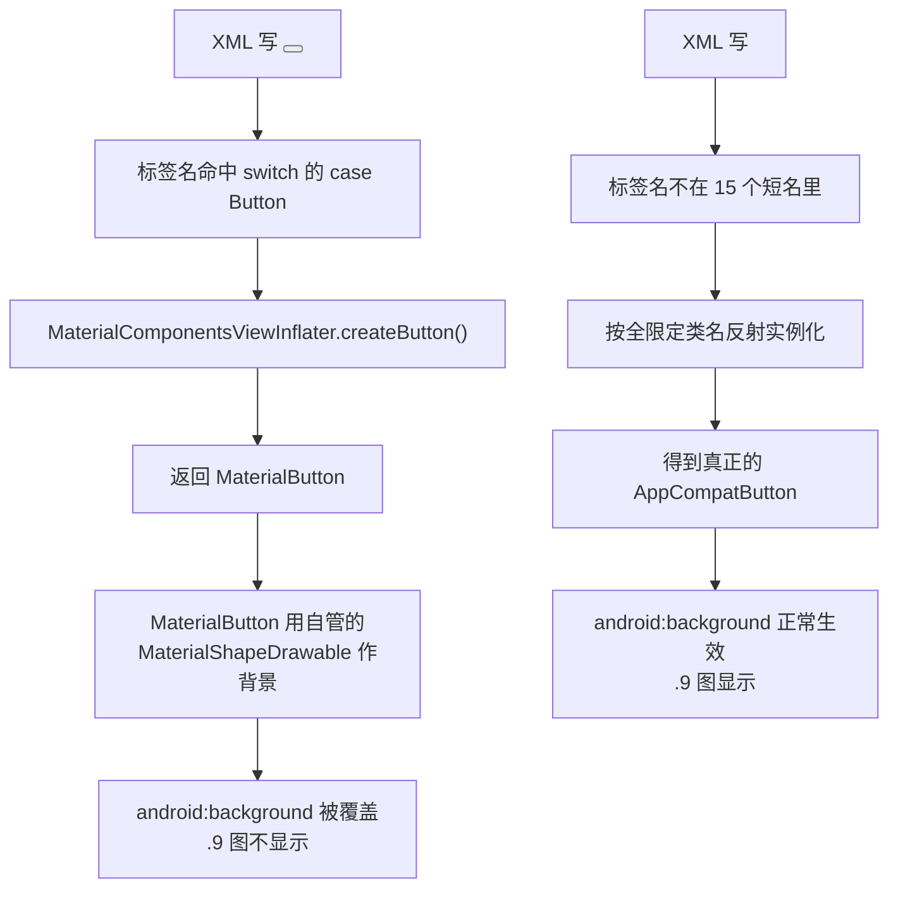

# 第 07 章　Drawable：shape / selector / 九宫格

> 所属模块：`:intermediatecontrols`
> 前置章节：第 06 章（Button 与点击事件）
> 涉及源码：`shape_rectangle.xml`、`shape_oval.xml`、`btn_nine_selector.xml`、`btn_background.xml`、
> `activity_drawable.xml`、`activity_drawable_state.xml`、`activity_drawable_nine.xml`、
> `DrawableActivity.java`、`DrawableStateActivity.java`、`DrawableNineActivity.java`

---

## 7.1 本章导读

### 学习目标

读完本章，你应该能够：

1. 说清 `Drawable` 到底是什么，以及它和"一张图片"的区别；
2. 用 XML 的 `<shape>` 手写一个按钮背景，并知道 `<solid>` / `<stroke>` / `<corners>` / `<gradient>` 各自管什么；
3. 用 `<selector>` 让一个背景在"默认 / 按下"两种状态下显示不同外观，并说清状态匹配的顺序规则；
4. 说清 `.9.png`（九宫格图）那圈 1 像素边框的作用，以及为什么普通图片被拉伸会变形；
5. 解释本章的核心谜题：**为什么同一个 `android:background`，写在 `<Button>` 上不显示，写在 `AppCompatButton` 上就正常。**

### 本章要回答的真实问题

这些问题不是编出来的，它们来自本项目 `:intermediatecontrols` 模块里作者自己写下的注释和踩坑记录：

- 为什么 `shape_rectangle.xml` 里同时写了 `<solid>` 和 `<gradient>`，到底哪个说了算？
- 为什么 `<selector>` 里两个 `<item>` 的顺序不能随便调换？
- 为什么 `nine_origin.9.png` 比 `origin.png` 恰好大 2 个像素？
- 为什么在 Material3 主题下，`<Button>` 的 `android:background` 会"消失"？

### 前置知识

- 第 06 章：`Button`、`findViewById`、`setOnClickListener` 与 `v.getId()` 分发；
- 对 XML 命名空间 `xmlns:android` 的基本认识；
- `res/drawable/` 目录与 `R.drawable.xxx` 的对应关系（第 05 章会展开讲 `R` 类的生成，这里先按"资源名 → 资源 id"理解）。

---

## 7.2 项目中的实际场景

在 `:intermediatecontrols` 模块里，有三个页面在讲"怎么给控件换外观"，它们的 Java 代码几乎一样——都只有 Edge-to-Edge 样板加一句 `setContentView`——真正的教学内容全在 XML 和资源文件里：

| Activity | 布局 | 演示什么 |
|---|---|---|
| `DrawableActivity` | `activity_drawable.xml` | 用 Java 代码在两种 `<shape>` 之间切换 |
| `DrawableStateActivity` | `activity_drawable_state.xml` | 用 `<selector>` 做"按下变色" |
| `DrawableNineActivity` | `activity_drawable_nine.xml` | `.9.png` 与普通图片的对比 |

这三个页面覆盖了 Android 里最常用的三类 Drawable。更有价值的是，`activity_drawable_nine.xml` 里作者留下了一段 7 行的中文注释，直接记录了一次真实的踩坑：**用 `<Button>` 时 `.9` 图完全不显示**。这段注释是本章第 7.7 节要解释的核心谜题，也是全书最"值钱"的一手材料之一——它不是从教程上抄来的，是自己撞出来的。

先看一个最基础的例子：`shape_rectangle.xml` 只有二十来行，却包含了 `<shape>` 的全部四种常用子标签。

---

## 7.3 核心概念：Drawable 不是图片

要理解本章所有内容，先要把一个概念摆正：

> **`Drawable` 不是图片，它是"一个知道怎么把自己画到画布上的对象"。**

这个区别很关键。你在 `res/drawable/` 目录下放的东西，可以是：

- 一张 PNG/JPG 图片（如 `origin.png`）→ 运行时是一个 `BitmapDrawable`；
- 一个 XML 文件（如 `shape_rectangle.xml`）→ 运行时是一个 `GradientDrawable`；
- 一个描述"不同状态下用哪张图"的 XML（如 `btn_nine_selector.xml`）→ 运行时是一个 `StateListDrawable`；
- 一张带 1 像素边框的特殊 PNG（如 `nine_origin.9.png`）→ 运行时是一个 `NinePatchDrawable`。

它们的共同点是：都实现了 `Drawable` 这个抽象类，都提供了 `draw(Canvas)` 方法。至于"画出来是什么"，完全由各自的实现决定——`GradientDrawable` 是按代码算出来的几何图形，`BitmapDrawable` 是把解码好的像素贴上去。

这解释了一件对初学者很反直觉的事：**`res/drawable/` 这个目录名其实不准确**，它装的不是"图片"，而是"可绘制对象"。目录名是历史遗留，改不了了。

用一张图理清本项目的四类 Drawable：



### 为什么用 Drawable，而不是直接切一张图

初学者常问："按钮的圆角背景，我让设计切一张图不就行了？"可以，但代价是：

1. **一张图只能对应一种尺寸和一种状态。** 圆角半径、颜色、按下态都得各切一张，图会爆炸式增长；
2. **改一个颜色要重新切图、重新打包。** 而 `<shape>` 里改一行 `#ffdd66` 就够了；
3. **图片不感知状态。** 按钮按下要变色，`BitmapDrawable` 自己做不到，得靠 `selector` 去"按状态选图"——但 `<shape>` 可以内联进 `selector` 的 `<item>` 里，一份文件搞定。

所以工程上的惯例是：**能用 XML 画的就用 XML 画，只有复杂图形（图标、照片）才用图片资源。** 本项目严格遵守了这条惯例——你看 `btn_background.xml`、`edit_text.xml` 这些背景，全都是 XML 画的，没有一张是切图。

---

## 7.4 用 XML 画图：`<shape>` 的四个子标签

打开 `intermediatecontrols/src/main/res/drawable/shape_rectangle.xml`，全文如下（保留了作者的注释）：

```xml
<?xml version="1.0" encoding="utf-8"?>
<shape xmlns:android="http://schemas.android.com/apk/res/android">

    <!--    指定形状内部的填充颜色-->
    <solid android:color="#ffdd66" />

    <!--    指定形状轮廓的粗细和颜色-->
    <stroke
        android:width="2dp"
        android:color="@color/black" />
    <!--    指定形状四个圆角的半径-->
    <corners android:radius="100dp" />

<!--    设置渐变-->
    <gradient
        android:angle="0"
        android:type="linear"
        android:centerColor="#ff0000"
        android:endColor="#0000ff"
        android:useLevel="false"
        />

</shape>
```

一个 `<shape>` 默认就是矩形（对应 `android:shape="rectangle"`），它的四个常用子标签分工如下：

| 子标签 | 作用 | 本例取值 | 说明 |
|---|---|---|---|
| `<solid>` | 纯色填充 | `#ffdd66`（浅黄） | 只支持 `android:color` |
| `<stroke>` | 描边 | 宽 `2dp`，色 `@color/black` | 还可设虚线 `dashWidth` / `dashGap` |
| `<corners>` | 圆角 | `android:radius="100dp"` | 也可四角分别设 `topLeftRadius` 等 |
| `<gradient>` | 渐变填充 | 线性，`angle=0` | 与 `<solid>` 互斥，见下 |

### 一个容易忽略的点：`<solid>` 和 `<gradient>` 同时存在，谁生效

本例里**两个都写了**。从 Android 的实现看，`<shape>` 最终被解析成 `GradientDrawable`；当 `<gradient>` 存在时，填充由渐变接管，`<solid>` 的颜色不再是最终填充色。也就是说，那个 `#ffdd66` 在肉眼上是看不到的。

这不是作者写错了，更像是在"试参数"的过程中两行都留下来了——这在自学项目里非常常见。想知道结论对不对，最好的办法是动手：把 `<gradient>` 整段注释掉，重新运行，你会看到纯 `#ffdd66` 的填充色出现。这个实验放在第 7.9 节。

### `<gradient>` 的几个属性

- `android:type`：`linear`（线性，默认）、`radial`（径向）、`sweep`（扫描）；
- `android:angle`：**仅对 `linear` 有效**，单位是度，且**必须是 45 的整数倍**。`0` 表示从左到右，`90` 表示从下到上，`270` 表示从上到下；
- `android:centerColor`：渐变中间的颜色，用来做"三色渐变"；
- `android:useLevel`：一般保持 `false`，只有把该 shape 当作 `ProgressBar` 的进度条背景时才需要 `true`。

本例只写了 `centerColor` 和 `endColor`，**没有写 `android:startColor`**。缺失的起点颜色会取默认值，所以这段渐变的实际观感需要你自己跑一遍确认——本文不替你下结论。

### 再看一个对比：`shape_oval.xml`

`shape_oval.xml` 的结构几乎一样，关键差别只有第一行：

```xml
<shape xmlns:android="http://schemas.android.com/apk/res/android"
    android:shape="oval">
<!--    默认是矩形 rectangle-->
```

把 `android:shape` 从默认的 `rectangle` 改成 `oval`，整个图形就变成椭圆（在正方形区域里就是圆）。作者还顺手留了一行注释"默认是矩形 rectangle"，正好点出这个属性的默认值。

注意一个细节：`shape_oval.xml` 里**没有** `<corners>`。因为椭圆没有"圆角"这个概念，写了也不生效——这是"子标签不是所有形状都通用"的例子。反过来说，`<solid>`、`<stroke>`、`<gradient>` 对矩形和椭圆都有效。

---

## 7.5 在 Java 代码里切换 Drawable

`DrawableActivity.java` 是本章唯一有实质逻辑的 Java 文件，它的核心只有几行：

```java
public class DrawableActivity extends AppCompatActivity implements View.OnClickListener {

    private View view_content;

    @Override
    protected void onCreate(Bundle savedInstanceState) {
        super.onCreate(savedInstanceState);
        // ... Edge-to-Edge 样板省略 ...
        setContentView(R.layout.activity_drawable);

        view_content = findViewById(R.id.view_content);
        Button btn_view_rectangle = findViewById(R.id.btn_view_rectangle);
        Button btn_view_oval = findViewById(R.id.btn_view_oval);

        btn_view_rectangle.setOnClickListener(this);
        btn_view_oval.setOnClickListener(this);

        view_content.setBackgroundResource(R.drawable.shape_rectangle);
    }

    @Override
    public void onClick(View v) {
        if(v.getId() == R.id.btn_view_rectangle){
            view_content.setBackgroundResource(R.drawable.shape_rectangle);
        } else if (v.getId() == R.id.btn_view_oval) {
            view_content.setBackgroundResource(R.drawable.shape_oval);
        }
    }
}
```

这里有几个值得停下来看的地方。

**第一，被换背景的控件是一个 `View`，不是 `TextView`。** 看布局 `activity_drawable.xml`：

```xml
<View
    android:id="@+id/view_content"
    android:layout_width="match_parent"
    android:layout_height="200dp"
    />
```

`View` 是所有控件的基类，它自己不会画任何内容。所以这块 200dp 高的区域在屏幕上**完全等于它的背景**——背景是矩形就是矩形，是椭圆就是椭圆。这恰好是对第 7.3 节那句"Drawable 是可绘制对象"最好的演示：没有文字、没有图标，你看到的就是 Drawable 本身。

**第二，`setBackgroundResource(int)` 收的是资源 id，不是 Drawable 对象。** 注意传进去的是 `R.drawable.shape_rectangle`——一个 `int`。它和下面这种写法是等价的：

```java
view_content.setBackground(getDrawable(R.drawable.shape_rectangle));
```

区别在于 `setBackgroundResource` 内部帮你做了"资源 id → Drawable 对象"的解析，而且这个解析是**延迟**的：真正的 Drawable 只有在需要绘制时才被创建。日常写代码用前者更省事。

**第三，点击分发用的是第 06 章讲过的 `v.getId()` 套路。** `implements View.OnClickListener` + `if/else if` 判断 id，这是本项目里出现频率最高的写法。注意这里用的是 `if / else if` 而不是 `switch`——`R.id.*` 在 AGP 8 之后不再是编译期常量，所以**不能再放进 `switch` 的 `case` 里**，这一点在第 06 章已经提过，这里不再展开。

**第四，`onCreate` 里也调了一次 `setBackgroundResource`。** 这保证了页面一打开就是圆角矩形，而不是"先空白、点一下才出现"。这是"初始状态要显式设置"的典型做法——`android:background` 只写在 XML 里当然也可以，但作者选择了在 Java 里统一设置，两种写法都对，只是风格不同。

---

## 7.6 状态选择器：`<selector>`

`<shape>` 解决的是"长什么样"，但按钮还有个绕不开的需求：**按下时要看起来像被按下了。** 这就是 `<selector>`（`StateListDrawable`）的职责——它本身不画任何东西，只负责"根据控件当前状态，决定用哪个 Drawable"。

### 写法 A：引用外部 Drawable

`btn_nine_selector.xml` 全文只有 6 行：

```xml
<?xml version="1.0" encoding="utf-8"?>
<selector xmlns:android="http://schemas.android.com/apk/res/android">

    <item android:drawable="@drawable/nine_origin" android:state_pressed="true" />
    <item android:drawable="@drawable/origin" />

</selector>
```

读法是：**从上往下逐条检查，第一个满足条件的 `<item>` 胜出。**

- 第 1 条要求 `state_pressed="true"`，即"手指正按在控件上"→ 用 `nine_origin`（那张 `.9.png`）；
- 第 2 条**没有写任何状态条件**，所以它无条件匹配，是"兜底项"→ 用 `origin`（普通图片）。

于是效果是：默认显示 `origin`，按住时切换成 `nine_origin`，松手又变回来。

### 顺序为什么不能随便调换

这是本章最容易踩、也最容易被忽视的一条规则。假如你把两行对调：

```xml
<item android:drawable="@drawable/origin" />
<item android:drawable="@drawable/nine_origin" android:state_pressed="true" />
```

结果就是**按下态永远不生效**。原因很直接：第 1 条没有任何条件，它在任何状态下都匹配成功，第 2 条根本没机会被检查到。所以 `<selector>` 里那条"无条件的兜底项"**必须放在最后一行**。这条规则和 CSS 里的"后定义覆盖前定义"正好相反，一定要记牢——第 7.9 节有对应的实验。

### 写法 B：把 `<shape>` 内联进 `<item>`

`btn_background.xml` 演示了另一种写法——`<item>` 里不引用外部文件，而是直接嵌一个 `<shape>`：

```xml
<selector xmlns:android="http://schemas.android.com/apk/res/android">
    <!-- 按钮被按下时的状态（变成浅灰色） -->
    <item android:state_pressed="true">
        <shape android:shape="rectangle">
            <solid android:color="#E0E0E0" />
            <corners android:radius="8dp" />
        </shape>
    </item>
    <!-- 按钮默认状态（白色背景） -->
    <item>
        <shape android:shape="rectangle">
            <solid android:color="#FFFFFF" />
            <corners android:radius="8dp" />
        </shape>
    </item>
</selector>
```

两种写法的差别在于**文件数量和复用方式**：

| | 写法 A（`btn_nine_selector.xml`） | 写法 B（`btn_background.xml`） |
|---|---|---|
| 结构 | `selector` 引用外部 drawable | `selector` 内联 `shape` |
| 文件数 | 需要额外的图片/XML 文件 | 一个文件写完 |
| 复用 | 同一张图可被多个 selector 共用 | shape 只服务于这个 selector |
| 适用 | 状态差异是"换图"（图片、`.9.png`） | 状态差异是"改颜色/圆角" |

**这里必须如实说明一件事**：我在全仓库范围内检索过 `@drawable/btn_background`，**当前没有任何布局引用它**。也就是说，`btn_background.xml` 是一个"定义了但还没接线"的资源。它依然是个很好的语法示例，但请不要误以为"项目里有个按钮用了它"——如果本文不写清这一点，你在自己的代码里找不到对应关系，反而会怀疑是不是自己漏看了。这正是本博客反复强调的原则：**源码是事实依据，不存在的引用不能编。**

---

## 7.7 九宫格：`.9.png` 的一像素边框

现在进入本章最硬核、也最容易被教程一笔带过的地方。

### 问题：普通图片被拉伸会变形

`activity_drawable_nine.xml` 里并排放了两个按钮，高都是 `100dp`，宽都是 `match_parent`：

```xml
<androidx.appcompat.widget.AppCompatButton
    android:layout_width="match_parent"
    android:layout_height="100dp"
    android:background="@drawable/nine_origin"
    android:text="@string/nine_image" ... />

<androidx.appcompat.widget.AppCompatButton
    android:layout_width="match_parent"
    android:layout_height="100dp"
    android:background="@drawable/origin"
    android:text="@string/normal_image" ... />
```

两个按钮尺寸完全一样，唯一的差别是背景图：上面用 `nine_origin`（`.9.png`），下面用 `origin`（普通 PNG）。

一张 `180 × 64` 的小图，被拉到一个宽度占满屏幕、高度 100dp 的按钮上，会发生什么？

- **普通 PNG**：整张图被"均匀缩放"——横向拉得很宽、纵向也拉。原本正圆的圆角会被拉成扁椭圆，描边也会横粗竖细，整个图形"走形"。
- **`.9.png`**：只有指定的中间区域被拉伸，**四个角保持原始尺寸不变**，所以圆角依然是正圆，图形不走形。

这就是九宫格（Nine-Patch）存在的全部意义：**允许你把一张小图安全地拉伸成大图。**

### 那圈 1 像素边框到底是什么

`.9.png` 的"九宫格信息"不是存在文件头里，而是**直接编码在图片最外圈的 1 个像素里**。规则是：

- **上边框和左边框**：黑色像素表示"这一行/列**可以**被拉伸"，透明像素表示"**不可以**拉伸"；
- **下边框和右边框**：黑色像素圈出内容的绘制区域（可理解为内边距）；
- 四种像素只允许是**纯黑不透明**或**全透明**，中间灰会被视为不合法。

所以一张 `.9.png` 比它的"正常版"恰好大 2 像素（左右各 1，上下各 1）。

### 本项目里的实测数据

这不是我从文档上抄的结论，是我直接解码这两个文件量出来的。用一段纯 Python（不需要任何第三方库）读 PNG 的像素，结果如下：

| 文件 | 尺寸 | 说明 |
|---|---|---|
| `nine_origin.9.png` | **182 × 66** | 带 1 像素边框 |
| `origin.png` | **180 × 64** | 不带边框 |

差正好是 `(2, 2)`。更进一步，我把 `.9.png` 去掉最外圈之后，和 `origin.png` **逐像素比对**：

```text
内容区 180 × 64 = 11520 个像素，不一致 0 个
```

也就是说，**这两张图是同一幅画**：`origin.png` 就是 `nine_origin.9.png` 剥掉边框的样子。这个结论 100% 可复现，你可以自己写几行脚本验证，比任何教程的说法都可靠。

再看边框的具体分布（坐标从 0 开始）：

```text
nine_origin.9.png  182 x 66

上边框 (y=0)   : [0..16] 透明(17px) | [17..164] 黑(148px) | [165..181] 透明(17px)
左边框 (x=0)   : [0..16] 透明(17px) | [17.. 48] 黑( 32px) | [ 49.. 65] 透明(17px)
```

翻译成人话：

- **横向**：左右各 17 像素是"固定区"（角），中间 148 像素是"可拉伸区"；
- **纵向**：上下各 17 像素是"固定区"（角），中间 32 像素是"可拉伸区"。

这正是"九宫格"这个名字的来源——整张图被切成 3 × 3 共九块，四个角原样保留，四边单向拉伸，中间双向拉伸。

### 编译期会被"剥壳"

还有一件值得知道的事：**这圈 1 像素边框只存在于源码里。** 构建时 aapt2 会把边框像素读出来、转成九宫格元数据，然后把边框从图片里**裁掉**。所以运行时真正加载的位图是 `180 × 64`，和 `origin.png` 一模一样大——差别只在"拉伸规则"这份元数据上。

理解了这一点，就能解释一个常见困惑：为什么在手机上抓一张 `.9.png` 的图，尺寸和源文件对不上。

---

## 7.8 关键设计原因：为什么 `<Button>` 上不显示

现在回到本章的核心谜题。`activity_drawable_nine.xml` 的作者注释是这样写的：

> 注意：这里必须用 AppCompatButton。本项目的主题是 `Theme.Material3.*`，Material 主题会把布局里的 `<Button>` 在充气（inflate）时替换成 `com.google.android.material.button.MaterialButton`，而 `MaterialButton` 自己管理背景，会覆盖掉 `android:background`，导致 `.9` 图完全不显示。`AppCompatButton` 是普通按钮，会正常使用 `android:background`。

这段话说的是现象和结论，都非常准确。但它没解释"为什么会被替换"。我把这条链路挖穿了，机制是这样的：

### 第一步：主题里藏着一个"视图充气工厂"

`AppCompatActivity` 在 `setContentView` 时，会给 `LayoutInflater` 装一个 `Factory2`——默认是 `AppCompatViewInflater`。它的工作是把 XML 里的标签名映射成具体的控件类（比如 `TextView` → `AppCompatTextView`）。

而 Material 主题（本项目是 `Theme.Material3.DayNight.NoActionBar`，它的父链最终会走到 `Base.V14.Theme.MaterialComponents.Light`）在样式里多设了一条：

```xml
<item name="viewInflaterClass">com.google.android.material.theme.MaterialComponentsViewInflater</item>
```

这条声明的意思是：**别用默认那个 inflater，用我这个。** 我在本地 Gradle 缓存里的 `material-1.10.0.aar` 中确认了这条样式的真实存在。

### 第二步：这个工厂把 `Button` 换成了 `MaterialButton`

`MaterialComponentsViewInflater` 继承自 `AppCompatViewInflater`，只重写了少数几个方法。其中 `createButton` 返回的不再是 `AppCompatButton`，而是 `MaterialButton`——`MaterialButton` 本身是 `AppCompatButton` 的子类，所以这个替换在类型上是"合法的"。

顺带一提，它同时还会把 `CheckBox` 换成 `MaterialCheckBox`、`RadioButton` 换成 `MaterialRadioButton`——**第 09 章那个"勾选图变成纯紫色方块"的坑，根子就在这里**，到时候会接着讲。

### 第三步：`MaterialButton` 不认 `android:background`

`MaterialButton` 的定位是"Material 设计规范下的按钮"，它需要自己控制背景来实现高度阴影、形状、涟漪和状态色。因此它内部会用 `MaterialShapeDrawable` 建立并管理自己的背景，把 XML 里写的 `android:background` 覆盖掉。

Material 库甚至为此内置了一条警告日志，原文是：

> MaterialButton manages its own background to control elevation, shape, color and states. Consider using backgroundTint, shapeAppearance and other attributes where available.

这段字符串就打包在 `MaterialButton.class` 里——也就是说，**你一旦在 `MaterialButton` 上设自定义背景，Logcat 里就应该能看到这条警告**。这给你提供了一个很好的验证手段，见第 7.9 节。

### 第四步：为什么写全限定名就能躲开

关键在这一句：**`AppCompatViewInflater` 的标签名匹配表里只有"短名"。**

我把 `appcompat-1.6.1.aar` 里 `AppCompatViewInflater.class` 的常量池翻出来看了，它在 `createView` 里用 `switch` 匹配的标签名一共 15 个，全是短名：

```text
TextView  ImageView  Button  EditText  Spinner  ImageButton  CheckBox  RadioButton
CheckedTextView  AutoCompleteTextView  MultiAutoCompleteTextView  RatingBar  SeekBar  ToggleButton
```

**没有** `androidx.appcompat.widget.AppCompatButton` 这样的全限定名。

于是两条路径彻底分开了：

- 写 `<Button>`：标签名命中 `case "Button"` → 走到被重写过的 `createButton()` → 拿到 `MaterialButton` → 背景被接管；
- 写 `<androidx.appcompat.widget.AppCompatButton>`：标签名不在那张短名表里 → 不经过任何映射 → `LayoutInflater` 直接按全限定类名反射实例化 → 拿到真正的 `AppCompatButton` → `android:background` 正常生效。

用一张图收尾：



### 一条可以带走的排查口诀

遇到"我在 Material 主题下给按钮设了背景，但没生效"，按这个顺序想：

1. 我用的是 `<Button>` 还是 `AppCompatButton`？→ 前者大概率被换成了 `MaterialButton`；
2. 我设的是 `android:background` 还是 `android:backgroundTint`？→ `MaterialButton` 认后者；
3. Logcat 里有没有那条 `MaterialButton manages its own background...` 警告？→ 有，就说明背景确实被接管了。

---

## 7.9 实验与验证

以下实验都能在 `:intermediatecontrols` 模块里直接做。**注意**：改源码前请先提交或备份，本博客的所有实验都要求"改完能改回来"。

### 实验一：验证 `<solid>` 被 `<gradient>` 盖住

1. 打开 `shape_rectangle.xml`，把整段 `<gradient>...</gradient>` 注释掉；
2. 运行 `DrawableActivity`，观察上方那块 `View` 的填充色；
3. **预期现象**：从"渐变色"变成纯 `#ffdd66` 的浅黄。
4. 把注释恢复，颜色又变回渐变。

这个实验同时验证了两件事：`<solid>` 确实被覆盖了，以及 `<shape>` 的改动是"改一行、立即见效"的。

### 实验二：验证 selector 的匹配顺序

1. 打开 `btn_nine_selector.xml`，把两个 `<item>` 对调位置；
2. 运行 `DrawableStateActivity`，**按住**第一个按钮不放；
3. **预期现象**：按住时背景**不再变化**（因为无条件的兜底项排在了第一位，永远先匹配成功）。
4. 调回来后按下态恢复。

这个实验比背规则有效得多。顺便说一句：`DrawableStateActivity.java` 里没有任何与状态相关的代码——状态匹配完全由 `StateListDrawable` 在框架层完成，这正是 `<selector>` 的价值所在。

### 实验三：亲眼看到 `MaterialButton` 的背景被接管

1. 打开 `activity_drawable_nine.xml`，把第一个按钮的标签从 `<androidx.appcompat.widget.AppCompatButton>` 改成 `<Button>`（结束标签也要一起改）；
2. 运行 `DrawableNineActivity`；
3. **预期现象**：这个按钮的 `.9` 图背景消失，变成一个普通的 Material 按钮外观；
4. 同时打开 Logcat，过滤 `MaterialButton`，**预期能看到** `MaterialButton manages its own background...` 这条警告。

如果第 4 步的警告出现了，就说明第 7.8 节的机制分析是对的——你不是在"相信一段解释"，而是亲手看到了证据。

### 实验四：自己量一遍 `.9.png` 的边框

1. 用 Android Studio 打开 `nine_origin.9.png`，右下角会自动切到九宫格编辑模式，你能直接看到那圈黑线；
2. 或者把图片放大到 800%，肉眼也能看清最外圈的黑边；
3. 想更严谨，可以写几行 Python 读 PNG 像素，复现本文第 7.7 节的数字（182×66、148 黑、32 黑）。

**预期结果**：和本文给出的表格一致。如果不一致，说明你量的是别的文件——请以你的实际输出为准，那才是事实。

---

## 7.10 本章总结

### 核心结论

1. **`Drawable` 是"可绘制对象"，不是图片。** `res/drawable/` 下既能放 PNG，也能放描述形状、状态、九宫格规则的 XML。
2. **`<shape>` 四个子标签**：`<solid>` 填充、`<stroke>` 描边、`<corners>` 圆角、`<gradient>` 渐变。`<gradient>` 存在时，`<solid>` 的颜色不再是最终填充色。
3. **`<selector>` 从上往下匹配，先匹配先赢。** 无条件的兜底 `<item>` 必须放最后。
4. **`.9.png` 的九宫格信息编码在最外圈 1 像素里**：黑色可拉伸、透明不可拉伸；上/左定义拉伸区，下/右定义内容区；编译期边框会被 aapt2 剥掉。
5. **本项目实测**：`nine_origin.9.png`（182×66）去掉边框后与 `origin.png`（180×64）逐像素完全一致，11520 个像素零差异。
6. **Material3 主题会把 `<Button>` 换成 `MaterialButton`**（通过 `viewInflaterClass`），而 `MaterialButton` 自管背景、覆盖 `android:background`。写全限定名 `androidx.appcompat.widget.AppCompatButton` 可以绕开这个替换，因为 `AppCompatViewInflater` 的标签匹配表里只有短名。

### 易错点清单

- 把兜底 `<item>` 写在 `<selector>` 第一行 → 按下态永远不生效；
- 在 `<oval>` 上写 `<corners>` → 写了也不生效；
- 在 Material 主题下用 `<Button>` 配 `android:background` → 背景被接管；
- 以为 `.9.png` 的文件尺寸就是运行时尺寸 → 编译期会剥掉 1 像素边框；
- 把 `btn_background.xml` 当成"项目在用的资源" → 它当前没有任何布局引用。

---

## 7.11 思考题

1. `shape_rectangle.xml` 里 `<corners android:radius="100dp" />` 给了一个相当大的圆角。如果这个 shape 被设到一个只有 `40dp` 高的控件上，圆角会怎样表现？先猜，再改代码验证。
2. `btn_nine_selector.xml` 目前只区分了"按下"和"默认"。请在不看文档的情况下，试着再加一个"禁用"状态（提示：`android:state_enabled="false"`），并想清楚它应该放在第几行。
3. 第 7.8 节说 `AppCompatViewInflater` 只匹配短名。那么 `<CheckBox>`、`<RadioButton>`、`<TextView>` 在 Material3 主题下分别会被换成什么类？请在 Android Studio 里用"断点 + 查看变量类型"或 Logcat 打印 `view.getClass().getName()` 验证你的答案。
4. 既然 `<gradient>` 会盖住 `<solid>`，那为什么 Android 不干脆在解析时把 `<solid>` 报错或忽略掉？结合"同一个 shape 可能被复用于不同状态"想一想，这种"宽容解析"带来了什么好处和什么坑。
5. **跨章思考**：第 09 章会讲 `CheckBox` 的自定义勾选图被"染成纯紫色方块"。结合本章第 7.8 节的机制，你觉得那个坑的成因和本章的 `<Button>` 坑是同一类问题吗？为什么？

---

> **下一章预告**：第 08 章《ImageView、scaleType 与图片资源》——同一个 `260dp` 高的 `ImageView`，为什么 8 种 `scaleType` 显示效果完全不同？届时会用到本章"图片原始尺寸 vs 控件尺寸"的结论。
